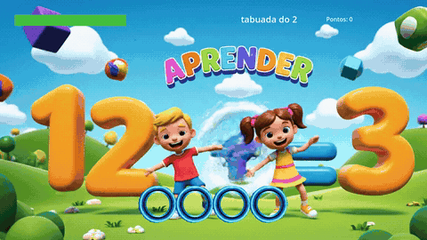
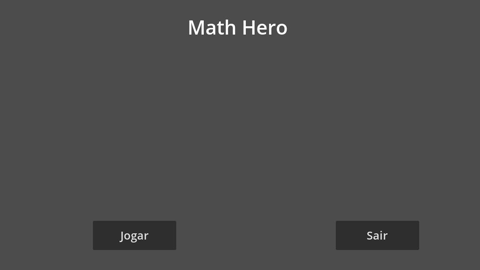
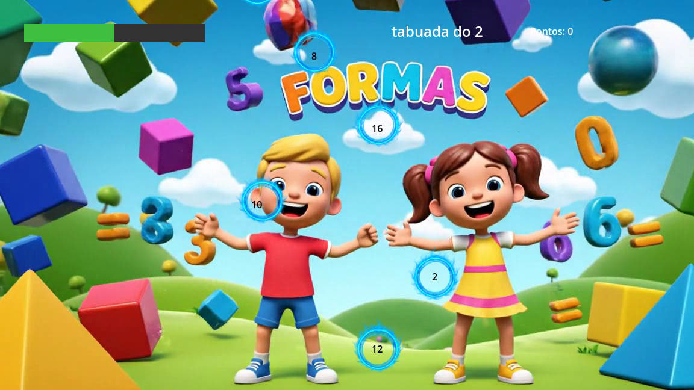

# 🎵 Math Hero — ritmo + tabuada

Jogo educativo de **ritmo** no estilo *Guitar Hero* para **praticar a tabuada**: notas com números descem por 4 pistas, e você só deve acertar as que forem **múltiplos da tabuada da vez**. Feito em **Godot 4.2 (GDScript)**.

🎮 **[Jogar no navegador](https://dimitri7.github.io/math-hero/)** *(teclado; no primeiro acesso, se aparecer um aviso de "SharedArrayBuffer", recarregue a página com F5)*



---

## 🕹️ Como jogar

| Tecla | Pista |
|---|---|
| **D** | 1 |
| **F** | 2 |
| **J** | 3 |
| **K** | 4 |

Aperte a tecla da pista **quando a nota chegar ao receptor**, mas só se o número for **múltiplo da tabuada** mostrada no topo (ex.: na tabuada do 3, acerte 9, 12, 21... e deixe passar 10, 14...).

## ✨ Regras e progressão

- **Combo**: cada acerto seguido multiplica os pontos da nota
- **Energia**: acerto recupera **2%**; erro tira **10%** e **500 pontos** (5 acertos compensam 1 erro). Energia zerada = **game over**
- **Níveis**: ao bater a meta de pontos, você sobe de tabuada, **do 2 até o 9**, e as notas ficam **mais rápidas**
- Menu, tela de game over (tentar de novo / voltar ao menu), música de fundo e efeitos de acerto e erro

| Menu | Partida |
|---|---|
|  |  |

## 🛠️ Tecnologias

**Godot 4.2** (renderizador *Compatibility*) · **GDScript** · exportação **Web (HTML5/WebAssembly)** publicada no GitHub Pages

## 🧠 Como está organizado

- **`GameManager`**: guarda o estado da partida (pontos, combo, energia, tabuada) e avisa a interface por **sinais** (`pontuacao_atualizada`, `combo_atualizado`, `energia_atualizada`, `tabuada_atualizada`, `game_over`)
- **`GeradorDeNotas`**: cria notas em pistas aleatórias, em intervalos aleatórios, sorteando números **certos (70%)** e **"pegadinhas" (30%)**, números que não são múltiplos da tabuada atual; a velocidade cresce a cada nível
- **`Receptor`**: uma por pista; ao apertar a tecla, verifica se há nota na área e se ela é correta
- **`InterfaceUI`** e **`game_over_ui`**: só reagem aos sinais, sem lógica de jogo
- **`AudioManager`**: música e efeitos em um único lugar

## 📁 Estrutura

```
Cenas/      cenas (.tscn) e o script do receptor
Scripts/    GameManager, GeradorDeNotas, InterfaceUI, AudioManager...
Audio/      música e efeitos
media/      GIF e prints deste README
docs/       versão Web exportada (publicada no GitHub Pages)
```

## ▶️ Como abrir o projeto

1. Instale o [Godot 4.2](https://godotengine.org/download/archive/4.2-stable/).
2. Abra o Godot → **Import** → selecione o arquivo `project.godot` desta pasta.
3. Aperte **F5** para jogar.

## 🙏 Créditos

- Música: **"Children's March Theme"**, de **Cleyton Kauffman** ([OpenGameArt](https://opengameart.org/content/childrens-march-theme), licença CC0).
- Fundo animado do jogo gerado com IA.

---

👤 **Dimitri Gomes de Albuquerque** · [GitHub](https://github.com/Dimitri7) · [LinkedIn](https://www.linkedin.com/in/dimitri-albuquerque-66b32b278/)
